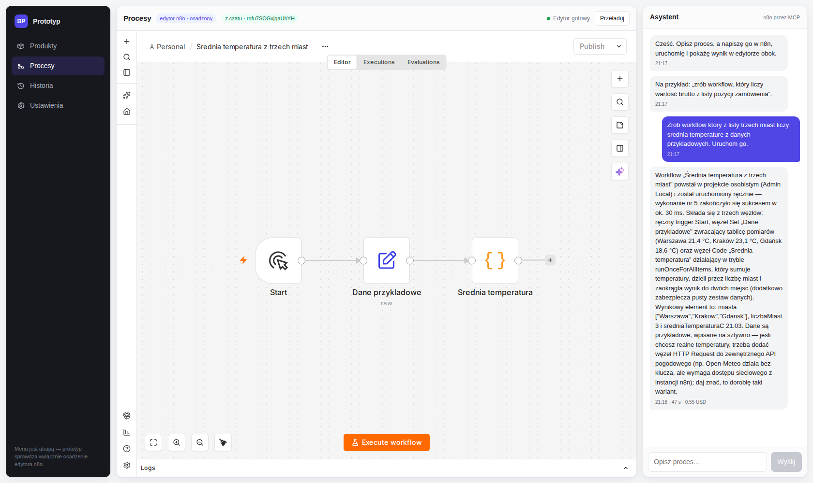
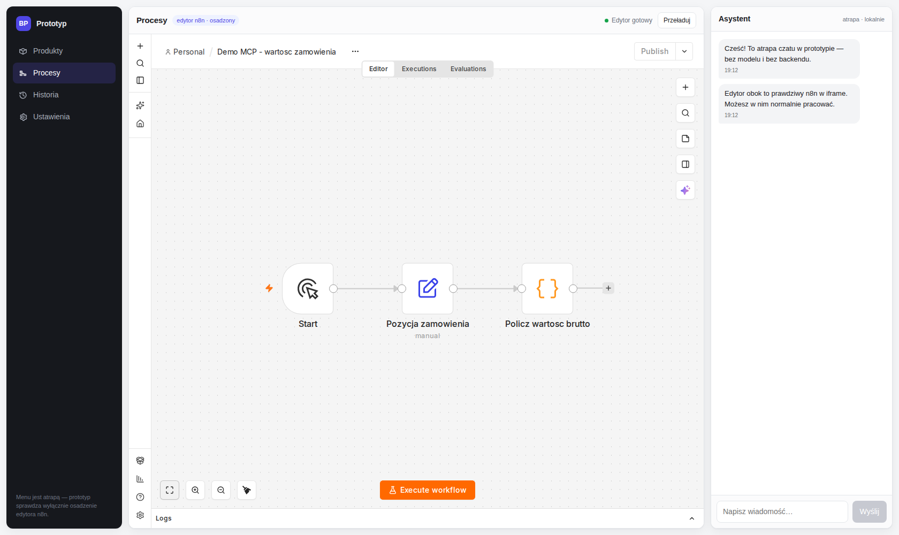

# Prototyp: React + edytor n8n w iframe

Sprawdzenie, czy oryginalny edytor n8n da się osadzić w aplikacji React i normalnie
z niego korzystać. Trzy panele: menu (atrapa), **prawdziwy edytor n8n w iframe**, czat (atrapa).


## Uruchomienie

```bash
cd /home/paczos/Documents/BetterProton/n8nIframe
docker compose up -d --build      # pierwszy raz (buduje frontend)
docker compose up -d              # kolejne uruchomienia
```

Aplikacja: **http://localhost:8080/**

Logowanie do n8n (konto zakładane automatycznie przy starcie): `admin@admin.com` / `Admin123`

## Zatrzymanie

```bash
docker compose stop     # zatrzymuje kontenery, dane zostają
docker compose down     # usuwa kontenery, wolumen n8niframe_n8n_data ZOSTAJE
```

Nie używaj `docker compose down -v` — to skasowałoby wolumen z workflowami n8n.

## Architektura

```
                         http://localhost:8080  (tylko 127.0.0.1)
                                    |
                            [ proxy: Caddy ]
                          /                    \
              /n8n/*  (prefiks obcinany)        pozostałe ścieżki
                     |                                 |
             [ n8n 2.38.7 ]                    [ frontend: nginx ]
          wolumen n8n_data                     build Vite (React+TS)
```

Trzy kontenery, jeden `docker-compose.yml`. Port na zewnątrz publikuje wyłącznie proxy,
i to tylko na `127.0.0.1` — nic nie wychodzi poza maszynę.

### Dlaczego jeden origin

Aplikacja i n8n są pod tym samym adresem `http://localhost:8080`, więc:

* ciasteczko sesji n8n (`n8n-auth`, `SameSite=Lax`, `Secure=false`) działa w iframe po HTTP —
  bez tego trzeba by `SameSite=None; Secure`, czyli HTTPS i własnego CA;
* `Content-Security-Policy: frame-ancestors 'self'` po stronie n8n przepuszcza tylko tę
  aplikację. Nagłówki bezpieczeństwa n8n zostają włączone, `X-Frame-Options: SAMEORIGIN`
  też jest spełniony. Nic nie jest globalnie wyłączane.

### Pułapka N8N_PATH (i dlaczego proxy obcina prefiks)

Dokumentacja n8n ostrzega, że `N8N_PATH` w połączeniu z reverse proxy potrafi psuć ścieżki.
W wersji 2.38.7 wygląda to konkretnie tak: `N8N_PATH=/n8n/` **przepisuje tylko adresy w
index.html** i ustawia `window.BASE_PATH='/n8n/'`, ale serwer nadal rejestruje wszystkie
trasy w korzeniu. Sprawdzone bezpośrednio na kontenerze:

```
GET n8n:5678/assets/index-*.js      -> 200 text/javascript
GET n8n:5678/n8n/assets/index-*.js  -> 200 text/html      (fallback SPA)
```

Efektem był pusty edytor i seria błędów „Expected a JavaScript module, got text/html".
Dlatego Caddy używa `handle_path /n8n/*`, które **odcina** prefiks: przeglądarka prosi
o `/n8n/assets/x.js`, n8n dostaje `/assets/x.js`. To samo dotyczy `/n8n/rest/*`
(API) i `/n8n/rest/push` (WebSocket).

### Konto i MCP z konfiguracji

Stack wstaje gotowy do pracy — bez ręcznego kreatora:

* `N8N_INSTANCE_OWNER_MANAGED_BY_ENV=true` + e-mail, imię, nazwisko i **hash bcrypt** hasła.
  n8n stosuje te wartości przy każdym starcie i blokuje edycję tego użytkownika w UI.
* `N8N_MCP_MANAGED_BY_ENV=true` i `N8N_MCP_ACCESS_ENABLED=true` — dostęp MCP na poziomie
  instancji (Settings → Instance-level MCP, status **Enabled**).

Zmiana hasła = nowy hash w `docker-compose.yml`:

```bash
python3 -c "import bcrypt; print(bcrypt.hashpw(b'NoweHaslo1', bcrypt.gensalt(rounds=10)).decode())"
```

W pliku Compose każdy `$` w hashu trzeba podwoić (`$$`), bo Compose interpretuje `$`.

## Czat, który pisze i uruchamia workflow

Prawy panel rozmawia z modelem, który ma do dyspozycji narzędzia MCP instancji n8n.
Napisz „zrób workflow, który…", a model napisze kod SDK, zwaliduje go, utworzy workflow,
uruchomi w trybie manual i opisze wynik — a iframe obok przeskoczy na to, co powstało.



Przepływ żądania:

```
przeglądarka  POST /api/chat
      ↓  Caddy
chat-backend  claude -p --mcp-config … --allowedTools mcp__n8n
      ↓  MCP (HTTP)
n8n           validate_workflow → create_workflow_from_code
              → execute_workflow (manual) → get_workflow_execution
      ↓
odpowiedź     { reply, workflowId, sessionId, costUsd, durationMs }
      ↓
iframe        /n8n/workflow/<workflowId>
```

Kontekst rozmowy trzymany jest przez `session_id` Claude Code (`--resume`), więc kolejne
wiadomości dotyczą tego samego wątku.

### Uwierzytelnianie i uprawnienia

Backend używa Twojego logowania Claude Code, bez klucza API. `~/.claude/.credentials.json`
montowany jest **read-only**, a entrypoint kopiuje go do zapisywalnego miejsca w kontenerze
— odświeżenie tokenu nie rusza pliku na hoście.

Model ma odcięte narzędzia lokalne (`--disallowedTools Bash,Read,Write,Edit,…`) i wpuszczony
wyłącznie serwer MCP n8n (`--strict-mcp-config --allowedTools mcp__n8n`). Nie ma dostępu do
Twoich plików ani powłoki.

### Poświadczenia wygasają — i co wtedy

Token OAuth Claude Code żyje kilka godzin; host odświeża go w tle, zmieniając
`~/.claude/.credentials.json`. Dlatego backend **kopiuje ten plik przed każdym zapytaniem**,
a nie raz przy starcie kontenera — kontener chodzący dobę miał inaczej kopię starszą niż
token i każde zapytanie kończyło się `OAuth session expired and could not be refreshed`.

Gdy token z hosta jest już przeterminowany, backend **celowo nie uruchamia CLI** i zwraca:

> Logowanie Claude Code wygasło. Uruchom `claude` na hoście (wystarczy raz) — odświeży
> token, a czat zacznie działać bez restartu kontenera.

Odświeżanie w kontenerze zrotowałoby refresh token, którego kopia i tak nie wróciłaby na
hosta — i wylogowałoby Cię na Twojej własnej maszynie. Stan poświadczeń widać pod
`GET /api/health`.

Testy tej logiki: `cd chat-backend && node --test test/credentials.test.mjs`.

### Koszt

Każda wiadomość to realne wywołanie modelu: obserwowane 30–50 s i **0,5–0,6 USD** za
zapytanie budujące workflow. Backend zwraca koszt i czas, a czat pokazuje je pod odpowiedzią.

## Połączenie MCP od strony konfiguracji

n8n wystawia serwer MCP pod `http://localhost:8080/n8n/mcp-server/http` (ten sam proxy,
ten sam prefiks). Claude Code jest do niego podłączony jako klient MCP:

```bash
claude mcp list          # n8n: ... - Connected
```

Rejestracja (token z Settings → Instance-level MCP → Connect → zakładka **API key**):

```bash
claude mcp add --transport http --scope local n8n \
  http://localhost:8080/n8n/mcp-server/http \
  --header "Authorization: Bearer <TOKEN>"
```

Token trafia do `~/.claude.json` (zasięg lokalny, tylko ten katalog projektu). Można go
w każdej chwili unieważnić lub przerotować w tej samej zakładce w n8n.

Serwer daje 35 narzędzi, m.in. `get_workflow_sdk_reference`, `validate_workflow`,
`create_workflow_from_code`, `execute_workflow`, `test_workflow`, `publish_workflow`,
`search_nodes`. Przykład przejścia end-to-end zapisany jest jako workflow
**„Demo MCP – wartość zamówienia"** (3 węzły, wykonanie #3, `netto 149.97 → brutto 184.46`).



Ograniczenie n8n: `execute_workflow` w trybie `production` wymaga opublikowanego workflow
z triggerem webhook/form/schedule/chat **oraz** włączonego dla niego dostępu MCP.
Tryb `manual` uruchamia bieżącą wersję z ręcznym triggerem i takich wymagań nie ma.

## Struktura

```
docker-compose.yml      trzy usługi + wolumeny
proxy/Caddyfile         routing i obcinanie prefiksu /n8n
frontend/               React + TypeScript (Vite), build serwowany przez nginx
  src/components/       Sidebar.tsx, EditorPanel.tsx (iframe), ChatPanel.tsx
docs/                   zrzuty ekranu z weryfikacji
```

## Zakres

Menu po lewej jest atrapą. Czat **nie** jest już atrapą — napędza go model przez MCP
(patrz niżej). Prototyp nadal nie zawiera integracji produktowych.
