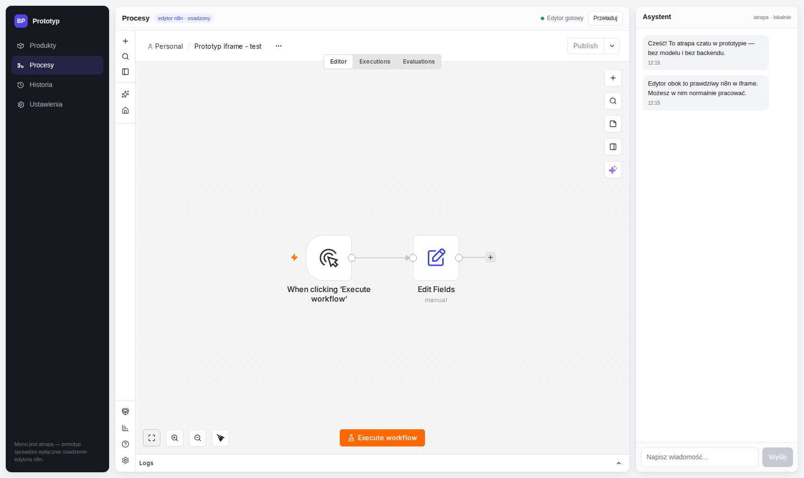

# n8nIframe — chat-driven workflow building around a process engine

This repository wraps workflow engines with a **chat layer that builds workflows for you**.
The product idea stays constant while the engine underneath changes:

* a React app embeds the engine's **full UI in an iframe** on a single origin (`http://127.0.0.1:8080`),
* a chat panel on the right drives an **LLM bot** (Claude Code CLI, GLM model) that authors, runs and
  reads back workflows through the engine's MCP/API,
* and the iframe jumps to whatever the bot just created or ran.

**n8n stays.** It is the original engine this prototype started with, and it remains on `main` as
the baseline and rollback reference — this project is not about throwing it away, it is about
wrapping it (and its alternatives) so that building a workflow is a conversation instead of
drag-and-drop.



## Branches — one engine per branch, all kept

| Branch | Engine | Status |
| --- | --- | --- |
| [`main`](https://github.com/kacperpaczos/n8niframe/tree/main) | **n8n** 2.38.7 | The original engine and baseline. Rollback reference for everything else. |
| `faza-1-dagu` *(this branch)* | **Dagu** 2.16.6 (pinned by digest) | The most complete wrap: 18/18 regression scenarios passed against the n8n baseline, end-to-end bot demo (GLM), full knowledge register and acceptance docs. |
| [`proba-bytechef`](https://github.com/kacperpaczos/n8niframe/tree/proba-bytechef) | **ByteChef** (upstream image) + Postgres 16 | Engine runs in the iframe with three demo workflows. Bot not yet adapted: it speaks Dagu's MCP; ByteChef ships a native Management MCP — adapter is pending. |

## Run this branch (Dagu)

```bash
cp .env.example .env
#   - DAGU_AUTH_TOKEN_SECRET:  openssl rand -hex 32
#   - SESJA_HASLO:             your operator password for the app
#   - the two Dagu API keys:   bootstrap procedure documented step-by-step
#                              in .env.example (Dagu Community allows max 2 keys)
docker compose up -d
```

App: **http://127.0.0.1:8080/** — log in with `SESJA_HASLO`; the iframe then shows the Dagu UI
(no second login; the proxy injects the engine token). n8n stays available behind
`docker compose --profile n8n up -d n8n` with its volume untouched.

Chat: type e.g. *"create a process that loads a JSON file, computes gross values per line and
returns the total"* — the bot writes the DAG through a contract-enforcing policy layer, runs it,
and the iframe follows the run.

## What was verified on this branch

* **18/18 regression scenarios** from the n8n baseline (iframe login, chat authoring + run +
  result readback, deep links, SSE live updates, restart persistence, port bound to `127.0.0.1`, …)
  — see `docs/odbior-faza-1.md`.
* **Data parity** on real fixtures extracted from n8n executions: values, types, precision,
  ordering — `docs/rejestr-workflow.md` §8.
* **All 15 n8n knowledge objects** (workflows, executions, account, keys, register of what is kept
  vs. written off) — accounted, nothing disappeared silently.

Key docs: `docs/raport-finalny-faza-1.md` (final report), `docs/decyzja-architektoniczna.md`
(architecture + trust boundary), `docs/wycofanie.md` (rollback to n8n, drilled on a copy),
`docs/audyt-dagu-bezpieczenstwo.md` (security verdicts).

## Repository layout

```
docker-compose.yml      stack: dagu / frontend / chat-backend / poswiadczenia / proxy (+ n8n behind a profile)
proxy/Caddyfile         routing, iframe headers, engine-token injection (variant B2)
frontend/               React + TypeScript (Vite) — menu, iframe panel, chat panel
chat-backend/           session gate, contract policy layer, Dagu MCP client, LLM CLI wiring
dags/                   process definitions (YAML + step scripts) — the chat writes here
fixtures/               data extracted from n8n executions, used for parity checks
docs/                   screenshots and documentation
```

## Security notes

`.env` and any credentials files are git-ignored and have never been committed. Demo passwords
that appear in the docs are intentionally public: this stack binds to `127.0.0.1` only and is a
local prototype, not a deployment.
